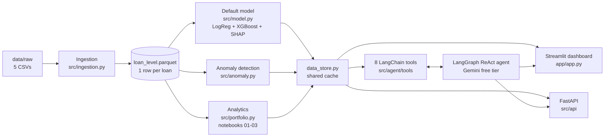

# Credit Risk Portfolio Monitor

This is a credit-risk monitoring dashboard I built on 5 synthetic bank tables (10,000 customers, 14,685 loans). It has two AI features built into it:

1. **Ask the Portfolio**: an agentic LLM assistant (LangGraph + Gemini). An analyst asks questions in plain English and gets short answers with the exact figures and their source. The LLM never calculates numbers itself. It only picks a tool, and pandas or the trained model computes the result.
2. **Anomaly detection**: a review list of accounts whose repayment or bureau behaviour is unusual compared with their own history or their peer segment. The analyst can confirm or dismiss each one.

Documents: [Architecture (1 page)](docs/architecture.pdf) | [Solution overview (1 page)](docs/solution_overview.pdf)

**Python version:** 3.12 (managed with [uv](https://docs.astral.sh/uv/))

---

## Quick start (3 commands)

```bash
uv sync                               # 1. install   (or: pip install -r requirements.txt)
uv run python main.py                 # 2. build the clean dataset and train the models
uv run streamlit run app/app.py       # 3. start the dashboard at http://localhost:8501
```

The REST API is optional and runs on the same code:

```bash
uv run uvicorn src.api.main:app --reload    # docs at http://127.0.0.1:8000/docs
```

### Setting the LLM API key

The chat uses the **Google Gemini free tier**.

1. Create a key at <https://aistudio.google.com/apikey>.
2. Locally: `cp .env.example .env` and fill in `GEMINI_API_KEY`.
   On Streamlit Community Cloud: add `GEMINI_API_KEY` under **App settings > Secrets**.
3. Optional: `GEMINI_MODEL` changes the model. The default is `gemini-3.5-flash-lite`, which is fast on the free tier.

**If no key is set**, the dashboard, model, account view and anomaly review still work as normal. Only the chat panel is turned off, and it shows a message asking for a key.

No keys are committed to this repo. `.env` and `.streamlit/secrets.toml` are git-ignored.

---

## What I found in the data

| Finding | Detail |
|---|---|
| Structurally clean | 0 duplicate keys, 0 orphan IDs across all 5 tables |
| Small planted gaps | 600 gender values coded `M`/`F`; 500 missing each in years employed, dependents and years at residence; 294 missing interest rates; 689 missing bureau DPD; 1,462 loans with no bureau record |
| Collections data leaks the target | Collections start after an account is already delinquent, so I kept it for the dashboard and left it out of the model |
| Signal is real but modest, and mostly linear | Income, missed EMIs, bureau DPD and loan-to-income drive risk. A simple model does as well as a complex one |
| Region does not matter | Default rate is flat at 15.0% to 16.9% across all five regions |

**Portfolio insights** (more detail in [notebook 02](src/analytics/02_portfolio_analytics.ipynb)):

1. **Mortgages are the biggest risk.** They are 9.8% of accounts but 58% of exposure, with a 24.7% default rate (1.5x the book).
2. **Income is the clearest gradient.** The lowest income quintile defaults at 25.5% vs 9.5% for the highest.
3. **Employment matters mainly at low income.** Contract workers default at 27.5% in the lowest income band but 10.7% in the highest. Unemployed in the lowest band is 38.2%.
4. **The first missed EMI is the early warning.** Default goes from 12.9% (0 missed) to 18.1% (1), 25.3% (2) and 33.5% (3).
5. **Loan-to-income has a cliff, not a slope.** Quintiles 1-4 sit at 13-16%, the top quintile jumps to 23.8%.

**Full profile** (default rate % / share of exposure %):

| Loan type | Income band | Age band | Employment | Region |
|---|---|---|---|---|
| Mortgage 24.7 / 58.2 | Q1 lowest 25.5 / 20.4 | 21-30: 20.8 / 26.5 | Unemployed 35.0 / 5.0 | South 16.9 / 26.1 |
| Credit Card 16.2 / 3.5 | Q2: 17.7 / 20.6 | 31-40: 16.7 / 33.7 | Contract 17.3 / 10.2 | North 16.4 / 21.5 |
| Business Loan 16.0 / 15.2 | Q3: 14.9 / 19.7 | 41-50: 13.8 / 27.5 | Self-Employed 15.3 / 20.5 | East 16.0 / 18.0 |
| Personal Loan 14.9 / 10.2 | Q4: 12.8 / 20.1 | 51-60: 11.1 / 10.2 | Salaried 15.0 / 52.1 | West 15.8 / 18.3 |
| Auto Loan 13.9 / 12.9 | Q5 highest 9.5 / 19.3 | 61-70: 7.2 / 2.1 | Business Owner 13.6 / 12.2 | Central 15.0 / 16.1 |

A prior bureau write-off (29% of loans) lifts default from 15.0% to 18.7%. The model's High and Very High bands are 38% of accounts but hold 65% of all defaults.

---

## Architecture



The full one-page diagram, including the tools at each stage, where the LLM is called and what data is sent to it, is in [docs/architecture.pdf](docs/architecture.pdf).

---

## Repository structure

```
README.md
requirements.txt            # every package pinned (exported from uv.lock)
pyproject.toml / uv.lock    # uv project
.env.example                # names of the keys, no values
main.py                     # build step: ingestion + model training
models/                     # trained models, metrics.json, account scores (committed)
app/
  app.py                    # Streamlit dashboard (entry point)
src/
  config.py                 # paths, constants, Gemini model name
  ingestion.py              # load, clean, join -> data/processed/loan_level.parquet
  portfolio.py              # segment profiling helpers
  model.py                  # LogReg + XGBoost, AUC/KS/Gini, SHAP, risk bands
  anomaly.py                # own-history + peer-segment rules, IsolationForest
  data_store.py             # cached data/model access shared by app, API and agent
  logging_config.py         # terminal logging with a trace id per request
  agent/
    tools/portfolio_tools.py        # 8 LangChain tools
    agent_model/portfolio_agent.py  # LangGraph agent, prompt, grounding check, streaming
  api/
    main.py                 # FastAPI app, request logging, error handlers
    errors.py
    routers/                # portfolio, model, anomaly, agent
  schemas/api.py            # Pydantic request/response models
  analytics/
    01_data_ingestion.ipynb
    02_portfolio_analytics.ipynb
    03_default_model.ipynb
    outputs/                # CSV tables written by the notebooks
data/raw/                   # the 5 CSVs as provided + DATA_DICTIONARY.md
docs/
  architecture.pdf
  solution_overview.pdf
  source/                   # LaTeX sources of the two PDFs (diagrams drawn in TikZ)
```

The trained models in `models/` are committed (about 740 KB), so the app starts straight away with exactly the model in this repo. `data/processed/` is git-ignored and is rebuilt from `data/raw/` in a few seconds on first start. Running `main.py` rebuilds both.

---

## Notebooks

| Notebook | What it covers |
|---|---|
| [01_data_ingestion.ipynb](src/analytics/01_data_ingestion.ipynb) | Loads each of the 5 tables one by one, profiles columns, missing values and keys, then merges them into one loan-level DataFrame and shows the data-quality log |
| [02_portfolio_analytics.ipynb](src/analytics/02_portfolio_analytics.ipynb) | Profiles by income, employment, region, age and loan type; risk vs exposure; employment x income heatmap; missed-payment and loan-to-income signals; the 5 insights with a "so what" each |
| [03_default_model.ipynb](src/analytics/03_default_model.ipynb) | Logistic regression vs XGBoost, 5-fold grouped CV, ROC and KS curves, score deciles, coefficients, SHAP, model choice and the monitoring plan |

The notebooks only present results. All the logic lives in `src/` and is imported, so the notebooks, the dashboard and the API always show the same numbers.

---

## Data ingestion

Output grain: **1 row per loan account** (14,685 rows, 68 columns).

```
loan_accounts (fact)
  |- LEFT JOIN customers               ON customer_id   many-to-one
  |- LEFT JOIN bureau aggregates       ON customer_id   22,979 lines  -> 1 row per customer
  |- LEFT JOIN repayment aggregates    ON account_id    176,220 months -> 1 row per account
  '- LEFT JOIN collections aggregates  ON account_id    sparse, zero-filled
```

I aggregate every child table to its join key before joining, so a loan can never be duplicated. Each join uses pandas `validate=`, and an assertion checks that the row count does not change.

| Issue | Rows | What I did |
|---|---|---|
| `gender` coded `M`/`F` | 600 | Mapped to `Male`/`Female` |
| `years_employed` missing | 500 | Median within employment type, plus a `_missing` flag |
| `num_dependents` missing | 500 | Median within marital status, plus a flag |
| `years_at_residence` missing | 500 | Median within housing type, plus a flag |
| `interest_rate_pct` missing | 294 | Median within loan type, plus a flag |
| Bureau `days_past_due` missing | 689 | 0 for aggregation; the missing count is kept as a feature |
| Bureau `date_closed` null | 11,243 | Expected for active lines, left as null |
| Loan has no bureau record | 1,462 | Bureau features set to 0, plus a `has_bureau_record` flag |
| Account has no collections | 10,407 | Collections features set to 0 |
| Duplicate keys / orphan IDs | 0 | Checked, none found |

No rows are dropped. I flag the imputed values because the fact that something is missing can itself carry risk signal. The full log is shown in the dashboard's Data quality tab.

---

## Default model

| Model (30% hold-out, split by customer) | AUC | Gini | KS | 5-fold CV AUC |
|---|---|---|---|---|
| **Logistic regression** (C=0.01, class-balanced) | **0.677** | **0.353** | **0.269** | 0.679 +/- 0.009 |
| XGBoost (depth 2, 600 trees, min_child_weight 50) | 0.671 | 0.343 | 0.271 | 0.678 +/- 0.008 |

- **Features:** customer profile, loan terms, bureau aggregates (write-offs, utilisation, DPD), repayment aggregates (missed EMIs, DPD trend, pay ratio) and the missing-value flags. Collections are excluded.
- **Validation:** train and test are split by customer, so loans of the same customer never sit on both sides. I tuned with `StratifiedGroupKFold` (5 folds, grouped by customer).
- **Why logistic regression is the champion:** it matches XGBoost on accuracy and every coefficient can be explained. Deeper XGBoost trees overfit (depth 4: train AUC 0.87 vs test 0.65). XGBoost is kept as the challenger and it drives the SHAP "key drivers" in the account view.
- **Calibration:** I first used class reweighting in XGBoost, which made the average predicted PD 45% against a real default rate of 16%. I removed it. Now the average PD is 16.3% and the risk bands match reality:

| Risk band | PD range | Accounts | Actual default rate | Suggested action |
|---|---|---|---|---|
| Low | < 8% | 2,422 | 5.0% | Approve |
| Medium | 8-16% | 6,621 | 10.6% | Approve |
| High | 16-30% | 4,219 | 22.8% | Refer to underwriter |
| Very High | >= 30% | 1,423 | 40.3% | Decline or ask for mitigation |

- **Why accuracy is not the headline:** only 16% of loans default, so predicting "no default" for everyone already scores 84% accuracy while catching nobody. AUC, KS and Gini measure how well the model ranks risk.
- **Monitoring after deployment:**

| What | How | When | Action trigger |
|---|---|---|---|
| Discrimination | AUC, KS, Gini on accounts whose outcome window has matured | Monthly | Gini drops more than 5 points |
| Stability | PSI on the score and the top 10 features | Monthly | PSI above 0.10 investigate, above 0.25 redevelop |
| Calibration | Predicted vs actual default rate by risk band | Quarterly | Any band off by more than 20% relative |
| Data quality | Missing rate and value ranges of the inputs | Every load | More than 2x the development rate |
| Overrides | How often analysts override the band, and the outcomes | Monthly | Override rate above 10% |

---

## Ask the Portfolio (agentic LLM)

I built this as a **LangGraph ReAct agent** (`create_react_agent`) on **Gemini 3.5 Flash-Lite (free tier)** with 8 LangChain tools:

| Tool | What it answers |
|---|---|
| `get_portfolio_overview` | Headline KPIs |
| `get_segment_breakdown` | Default rate, exposure and risk lift by any dimension, with optional filters |
| `get_cross_tab` | Any two dimensions, e.g. employment x income |
| `get_account_risk` | PD, risk band and top SHAP drivers for one account |
| `get_top_risk_accounts` | Highest-PD accounts, with optional filters |
| `predict_default_probability` | Scores a new applicant with the trained model |
| `get_model_performance` | AUC / Gini / KS and top features |
| `get_anomaly_summary` | Flagged accounts and the reasons |

**How a question flows:**

```
question -> Gemini picks a tool -> tool computes exact figures (pandas / model)
         -> Gemini writes 2-4 sentences from that result only (or calls another tool)
         -> Python checks every number in the answer exists in the tool output
         -> answer streams into the chat with its source
```

- **No hallucinated numbers:** the system prompt forbids estimating, and the grounding check flags any figure that is not in the tool output.
- **Declines what it cannot answer:** forecasts, macro questions and data that is not in the portfolio get a `DECLINED:` reply.
- **New applicant prediction:** if fields are missing it asks for them. It also states how it mapped free text (e.g. "mortage" -> Mortgage, "software engineer" -> Salaried) and which fields were filled with portfolio typical values.
- **What is sent to Gemini:** the question, recent chat turns, the system prompt, tool descriptions and the tool results (aggregates, or the one account asked about). Raw customer tables are never sent.
- **Speed:** about 1-4 seconds per answer, streamed word by word.
- **Example questions:** *Which loan type has the highest default rate?* | *Default rate by employment type for the lowest income band?* | *Why is ACC200001 high risk?* | *Score an applicant with income 50000, loan 200000, mortgage, salaried.*

---

## Anomaly detection

- **Own history:** compares the last 3 months with earlier months. It fires on a DPD jump of 20+ days, or 2+ new missed EMIs after a clean record.
- **Peer segment:** a robust z-score of 4 or more against the same loan type x income band, on repayment DPD, missed rate, bureau DPD, utilisation and write-offs.
- **Ranking:** an IsolationForest score orders the flags.
- **Result:** 938 accounts flagged (6.4%). They default at **25.2% vs 16.1%** for the book, so the flags point at real risk.
- **Human in the loop:** the analyst confirms or dismisses each flag with a note. The decision is logged with a timestamp and reviewer.

The trigger, false positive, false negative and human-review step for both AI features are explained inside the dashboard.

---

## Streamlit dashboard

| Area | What it shows |
|---|---|
| Sidebar | Filters: loan type, region, employment, income band, risk band |
| KPI row | Accounts, default rate vs book, exposure, defaulted exposure, flagged anomalies |
| Portfolio tab | Exposure by risk band, default rate by origination year, profile for any dimension, cross-tab heatmap, drill-down to accounts |
| Account tab | PD, risk band, actual outcome, SHAP drivers, account facts, monthly repayment chart |
| Anomaly review tab | Flagged list with reasons, Confirm / Dismiss, decision log |
| Model tab | Validation metrics and SHAP feature importance |
| Data quality tab | Every cleaning decision |
| Right panel | Ask the Portfolio chat with streaming answers |

---

## REST API (FastAPI)

The API serves the same logic as the dashboard. Interactive docs are at `/docs`.

| Method | Endpoint | Purpose |
|---|---|---|
| GET | `/health` | Status, and whether the LLM key is configured |
| GET | `/portfolio/kpis` | Headline KPIs |
| GET | `/portfolio/segments/{dimension}` | Profile by one dimension |
| GET | `/portfolio/crosstab?rows=&columns=&metric=` | Two-dimensional table |
| GET | `/model/metrics` | AUC / Gini / KS and top features |
| GET | `/model/accounts/{account_id}` | PD, band and SHAP drivers for one account |
| GET | `/model/accounts/top?n=&loan_type=` | Highest-risk accounts |
| POST | `/model/predict` | Score a new applicant |
| GET | `/anomalies?limit=&flag_type=` | Anomaly review list |
| POST | `/anomalies/{account_id}/decision` | Confirm or dismiss a flag |
| GET | `/anomalies/decisions` | Decision log |
| POST | `/agent/ask` | Ask the Portfolio |
| GET | `/agent/about` | Trigger, false positive, false negative and human review text |

Example:

```bash
curl -X POST http://127.0.0.1:8000/agent/ask \
  -H "Content-Type: application/json" \
  -d '{"question": "Which loan type has the highest default rate?"}'
```

Errors come back with a clear `error_code`, such as `llm_not_configured`, `llm_rate_limited`, `llm_overloaded`, `llm_timeout` or `validation_error`. Every request is logged to the terminal with a trace id, which is also returned in the `X-Request-ID` header.

---

## Where each item of the brief lives

| Brief item | Location |
|---|---|
| 1. Data ingestion + data quality | `src/ingestion.py`, `src/analytics/01_data_ingestion.ipynb` |
| 2. Portfolio analytics + insights | `src/portfolio.py`, `src/analytics/02_portfolio_analytics.ipynb` |
| 3. Default model (AUC/KS/Gini, SHAP, monitoring) | `src/model.py`, `src/analytics/03_default_model.ipynb` |
| 4. Dashboard | `app/app.py` |
| AI feature 1: Ask the Portfolio | `src/agent/` |
| AI feature 2: Anomaly detection | `src/anomaly.py`, decisions in `src/data_store.py` |
| REST API | `src/api/` |
| Architecture diagram | `docs/architecture.pdf` |
| Solution overview | `docs/solution_overview.pdf` |

---

## Assumptions and limits

- Exposure = latest outstanding balance. `target_default` is taken as given.
- Repayment history covers 12 months per account; "recent" means the last 3 months.
- For a new applicant, fields that are not given are filled with portfolio typical values, so that score mainly reflects income, loan amount, loan type and employment.
- Analyst decisions are stored in a CSV, which resets when the hosted app restarts. In production this would go to a database.
- The data is synthetic.
